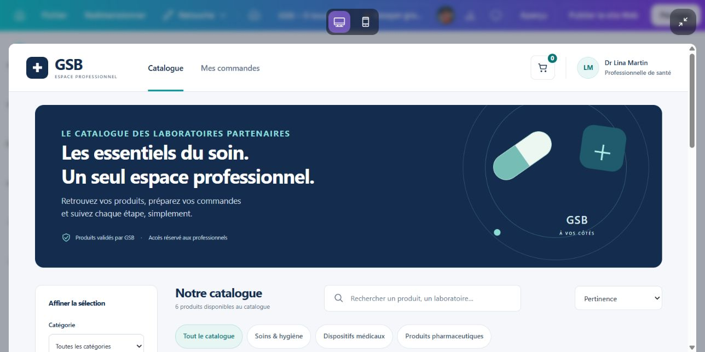
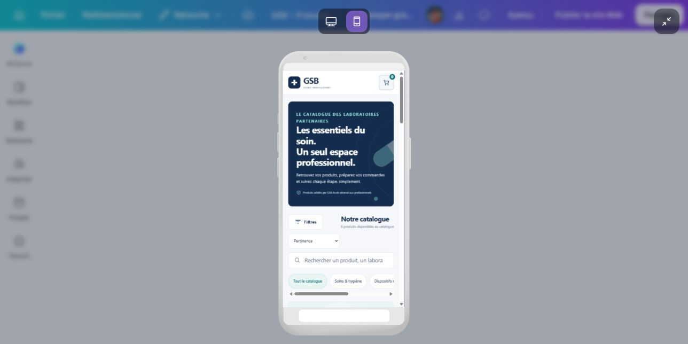

# GSB Projet — Plateforme e-commerce Galaxy Swiss Bourdin

Application web permettant au laboratoire pharmaceutique **GSB** de proposer à ses
professionnels de santé (médecins, pharmaciens...) un catalogue de médicaments,
un système de commande en ligne et un espace d'administration.

Sujet de labo : voir `docs/sujet.pdf` (à ajouter) — synthèse ci-dessous.

📄 [Cahier des charges](docs/Cahier_des_charges_GSB.docx) — historique des versions dans les commits de ce fichier.
🗂️ [Dictionnaire de données](docs/GSB_Dictionnaire_de_donnees.png) (source éditable : [.drawio](docs/GSB_Dictionnaire_de_donnees.drawio)) — 13 tables, 84 attributs.

## Stack imposée

| Couche | Techno |
|---|---|
| Front-end | React |
| Back-end | Node.js + API REST |
| Base de données | SGBD relationnel (MCD/MLD/MPD — méthode Merise) |
| Gestion de projet | GitHub Issues + Projects |

## Calendrier

Début : 16 septembre 2026 — Remise : **31 décembre 2026** (3,5 mois).

## Feuille de route (6 phases)

Le détail de chaque phase (tâches, sous-tâches, critères de fin) est dans les
[Milestones](../../milestones) et les [Issues](../../issues) du dépôt. Ce découpage reprend
exactement celui du cahier des charges (section "Organisation du projet").

| # | Phase | Part | Échéance |
|---|---|---|---|
| 1 | Analyse | 15% | 02/10/2026 |
| 2 | Conception | 20% | 23/10/2026 |
| 3 | Développement du socle | 20% | 13/11/2026 |
| 4 | Développement métier | 25% | 09/12/2026 |
| 5 | Tests et corrections | 15% | 25/12/2026 |
| 6 | Livraison | 5% | 31/12/2026 |

### 1. Analyse ✅
Recueillir les exigences et besoins.
- ✅ Rédiger / finaliser le cahier des charges (`docs/Cahier_des_charges_GSB.docx`)
- ✅ Lister les besoins fonctionnels et non fonctionnels
- ✅ Identifier les profils utilisateurs (professionnel de santé, fournisseur, administrateur)
- ✅ Définir les contraintes techniques et organisationnelles

### 2. Conception
Architecturer et maquettiser.
- ✅ Modèle Conceptuel de Données (MCD)
- ✅ Modèle Logique de Données (MLD)
- ✅ Modèle Physique de Données (MPD) + script SQL ([`docs/MPD.md`](docs/MPD.md), [`database/schema.sql`](database/schema.sql))
- ✅ Maquettes des écrans principaux : 43 pages ordinateur, 16 pages mobile et prototype interactif ([`docs/maquettes/`](docs/maquettes/), voir `LISEZ-MOI.txt`)
- Architecture technique (arborescence front/back, routes API)
- Diagramme de Gantt

### 3. Développement du socle
Authentification, rôles, base MySQL, structure React/Express.
- Setup back-end Node.js + API
- ✅ Setup front-end React (Vite, styles, boutons, champs, logo, barre du haut)
- Authentification sécurisée
- Espace personnel

### 4. Développement métier
Catalogue, panier, commandes, administration, fournisseurs, recherche.
- Catalogue de médicaments, panier et commandes, historique
- Interface d'administration, gestion des fournisseurs
- Recherche et filtrage

### 5. Tests et corrections
Tests fonctionnels, sécurité, intégration, correction des anomalies.

### 6. Livraison
Jeu de données, documentation, démonstration, préparation de la soutenance.

## Fonctionnalités attendues (epics)

1. **Authentification sécurisée** — comptes créés uniquement par l'admin, changement de mot de passe obligatoire à la première connexion
2. **Espace personnel** — consultation/modification des infos utilisateur
3. **Catalogue de médicaments** — par catégories, fiche produit (nom, description, image, prix HT/TTC)
4. **Panier** — ajout/retrait, quantités, récapitulatif HT/TTC, validation → commande
5. **Historique des commandes** — liste + détail
6. **Interface d'administration** — CRUD comptes, CRUD produits, consultation des commandes
7. **Gestion des fournisseurs** — comptes dédiés pour ajouter/gérer leurs produits, sous contrôle admin
8. **Recherche et filtrage** — par catégorie, nom, etc.

## Livrables

- [ ] Code source complet (front + back + script BDD)
- [x] ✅ Cahier des charges
- [x] ✅ Modèles Merise (MCD, MLD, MPD)
- [x] ✅ Maquettes et prototype interactif ([`docs/maquettes/`](docs/maquettes/))
- [ ] Diagramme de Gantt
- [ ] Démonstration de l'application

## Aperçu des maquettes

Prototype interactif : ouvrir [`docs/maquettes/GSB_Canva_Prototype_interactif.html`](docs/maquettes/GSB_Canva_Prototype_interactif.html) dans un navigateur (aucune installation nécessaire).

**Ordinateur** (43 pages)



**Mobile** (16 pages)



## Où on en est (31/10/2026)

**Front-end React (branche `kelian`)** : on code avec des données fictives, étape par étape ([`docs/FEUILLE_DE_ROUTE_CODE.md`](docs/FEUILLE_DE_ROUTE_CODE.md)).

| Étape | Contenu | État |
|---|---|---|
| 0 | Projet Vite + React qui démarre | ✅ fait |
| 1 | Styles (couleurs, texte), `Button`, `Input` | ✅ fait, il reste `Alert`, `Badge`, `Loader`, `Modal`, `EmptyState` |
| 2 | Logo et `Header` (barre du haut) | ✅ fait, il reste `Footer`, `Sidebar`, `Breadcrumb`, `PageHeader`, layouts, routes |
| 3 | Connexion avec données fictives | à faire |
| 4 | Catalogue (bandeau, filtres, fiche produit) | à faire |
| 5 à 10 | Panier, commandes, espace personnel, admin, fournisseur, qualité | à faire |

**Back-end Node.js** : pas commencé (après le front).

**Fichiers restant à écrire** : la liste complète (29 fichiers) est dans [`docs/fichiers-a-ecrire.pdf`](docs/fichiers-a-ecrire.pdf). Ce qui est déjà écrit est expliqué dans [`docs/recap-front.pdf`](docs/recap-front.pdf).

## Lancer le front

```
cd frontend
npm install
npm run dev
```

## Développement

Plan étape par étape : [`docs/FEUILLE_DE_ROUTE_CODE.md`](docs/FEUILLE_DE_ROUTE_CODE.md). On commence par le front avec des données fictives, puis on branche le back-end.

## Structure du dépôt

```
docs/           cahier des charges, Merise, maquettes, récapitulatifs du front
backend/        API Node.js (à venir)
frontend/       application React (en cours)
database/       scripts SQL
```
